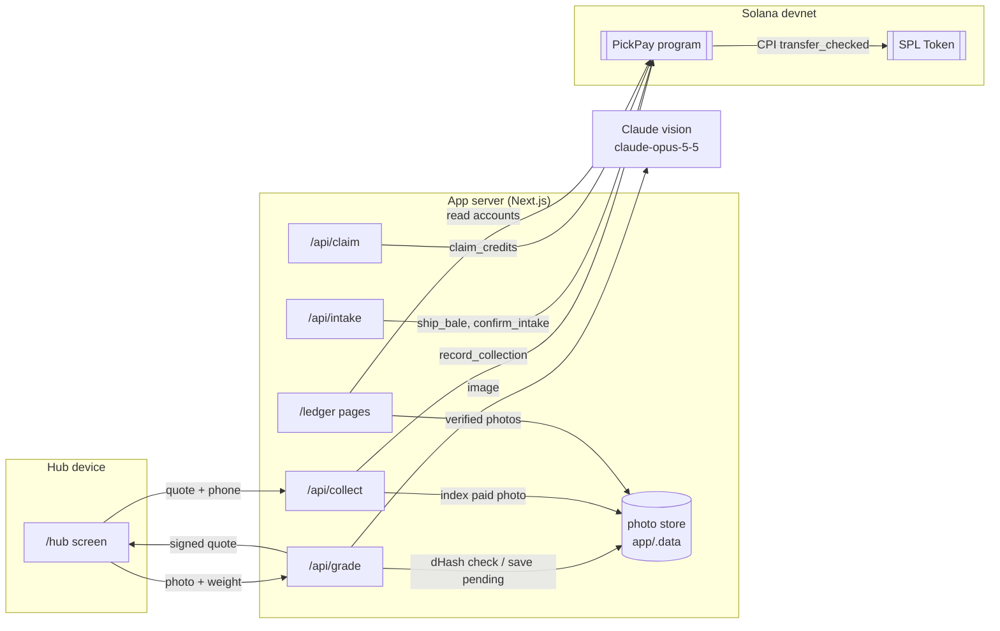
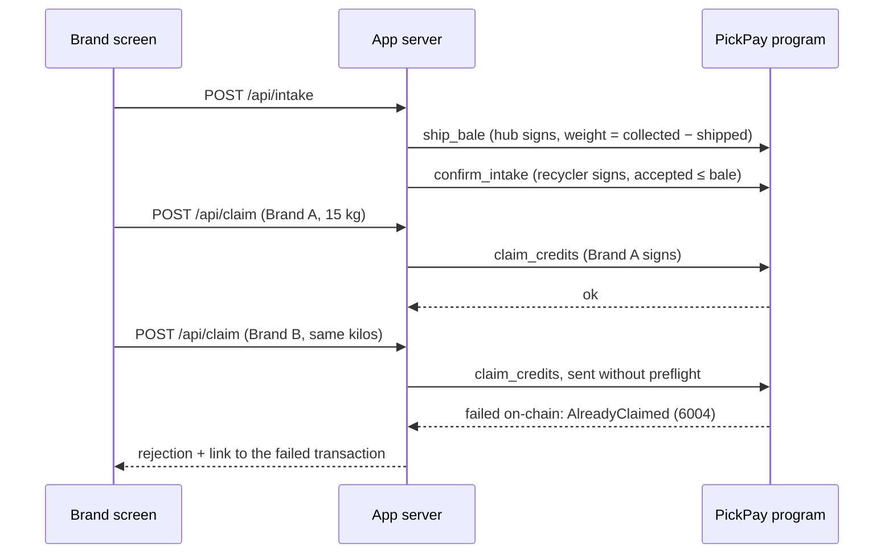

# PickPay architecture and technical spec

PickPay has three parts: an Anchor program on Solana that holds every fact and enforces the rules, a Next.js app that the hub, recycler and brands use, and Claude vision, which grades bag photos. There is no database. The app reads chain state for every screen; the hub keeps only bag photos and their perceptual hashes.

## System



## On-chain program

Program ID (devnet): `47EHi4xhP3o6T7TUsMVRNMse4Xdcs1zRHLXxSpncgLTz`. Anchor 1.2, built for SBPF v1 (`anchor build --arch v1`). Weights are stored in grams and payouts in the payout mint's base units (6 decimals).

### Accounts

| Account | Seeds | Holds |
|---|---|---|
| `Hub` | `"hub", authority` | authority, payout mint, escrow, `collected_g`, `shipped_g`, `paid_total`, `owed_total`, `collection_count`, `bale_count`, `next_unbaled` |
| Escrow (SPL token account) | `"escrow", hub` | the hub's payout float; owned by the hub PDA, so only the program can move it |
| `Collection` | `"collection", hub, index (u64 LE)` | one bag: picker hash, paid-to wallet (or default for accrued), weight, polymer, contamination (bps), amount, photo SHA-256, time |
| `PhotoSeal` | `"photo", photo_sha256` | exists once per photo hash, so the same photo can't back two bags |
| `Picker` | `"picker", hub, picker_hash` | per-picker totals and the balance owed to pickers without a wallet |
| `Bale` | `"bale", hub, index` | weight shipped, the recycler named to receive it, the range of bags it carries, intake flag |
| `CreditBatch` | `"credits", bale` | recovery credits from a recycler's intake: accepted g, claimed g, claim count |
| `Claim` | `"claim", credit_batch, index` | one brand retiring part of a batch |

`picker_hash` is SHA-256 of a server-side salt and the E.164 phone number. Phone numbers never reach the chain.

### Instructions

| Instruction | Signer | Effect | Rejects |
|---|---|---|---|
| `init_hub` | hub authority | creates `Hub` and its escrow token account | |
| `record_collection(args)` | hub authority | creates `Collection` and `PhotoSeal`, updates `Picker` and hub totals; transfers `amount` from escrow to the picker's token account in the same instruction, or adds it to `Picker.owed` if no token account is passed | zero weight; contamination > 10,000 bps; payout account on the wrong mint; a photo hash already sealed |
| `ship_bale(weight_g, recycler)` | hub authority | creates `Bale` for the bags recorded since the last bale; `shipped_g += weight_g` | `ExceedsCollected` if `shipped_g` would pass `collected_g` |
| `confirm_intake(accepted_g)` | the bale's recycler | creates the bale's single `CreditBatch` with `accepted_g` | `WrongRecycler`; `ExceedsIntake` if `accepted_g > bale.weight_g`; a second intake (batch already exists) |
| `claim_credits(weight_g)` | brand | creates `Claim`; `claimed_g += weight_g` | `AlreadyClaimed` if `claimed_g` would pass `accepted_g` |

The invariant **collected ≥ shipped ≥ credited ≥ claimed** follows: shipping is capped by collection per hub, credits by the bale they came from, and claims by the batch. All arithmetic is checked (`Overflow` on failure).

### Tests

`programs/pickpay/tests/` runs 11 LiteSVM tests against the compiled program: escrow setup, payout to a wallet in the same transaction, accrual without a wallet, duplicate photo, invalid inputs, wrong payout mint, the full bag → bale → credit → claim chain, `ExceedsCollected` (including across two bales), `ExceedsIntake` and double intake, wrong recycler, and a second brand claiming retired credits.

## Collecting a bag

```mermaid
sequenceDiagram
  participant H as Hub screen
  participant S as App server
  participant AI as Claude vision
  participant P as PickPay program
  H->>S: POST /api/grade (photo, weight)
  S->>S: SHA-256 + 64-bit dHash; reject near-duplicate of a paid photo
  S->>AI: image + grading rubric (JSON schema output)
  AI-->>S: polymer, contamination, confidence, note
  S->>S: price = rate(polymer) × (1 − contamination) × weight
  S-->>H: grade, ₦ total, HMAC-signed quote
  H->>S: POST /api/collect (quote, phone, wallet?)
  S->>S: verify quote; photo seal and dHash checks; salted phone hash
  S->>P: record_collection (+ create the picker's token account if needed)
  P->>P: transfer_checked escrow → picker
  P-->>S: confirmed (~1 s on devnet)
  S->>S: store photo, index its dHash
  S-->>H: paid, explorer link
```

## Recycling and claiming



Claims skip preflight on purpose: the rejection lands on-chain, so the explorer shows the program's own error rather than a server-side check.

## App

| Route | Role |
|---|---|
| `/hub` | Mobile screen for the hub agent: phone, optional wallet, weight, photo → grade → pay |
| `/brand` | Hub totals, recycler intake, credit batches, claims as Brand A or B, live results |
| `/ledger`, `/ledger/[claim]` | Public trace of every claim down to the bags, from chain state |
| `/api/grade` | Duplicate check, Claude grading, pricing, signed quote |
| `/api/collect` | Verifies the quote, sends `record_collection`, stores the photo |
| `/api/intake`, `/api/claim` | Recycler and brand transactions |
| `/api/ledger`, `/api/photo/[sha]` | Chain reads and paid photos |

- **Grading:** `claude-opus-5-5` at low effort with a JSON schema output and server-side fallback on refusal. The model sets polymer and contamination; pricing is deterministic integer maths in `app/src/lib/pricing.ts` (demo rates: PET ₦300/kg, HDPE ₦250/kg, mixed ₦100/kg, discounted by contamination).
- **Signed quotes:** `/api/grade` signs `{photo SHA-256, dHash, weight, polymer, contamination, amount, expiry}` with an HMAC key derived from the hub's secret; `/api/collect` pays only a valid, unexpired quote.
- **Duplicate photos:** exact reuse is stopped on-chain by `PhotoSeal`; near-duplicates (≤10 of 64 dHash bits differ) are stopped by the hub's index before grading and again before payment.
- **Client:** `@solana/kit` 8.5 with a Codama-generated client (`pnpm generate:client`); PDAs whose seeds use instruction data or counters are derived in `app/src/lib/pdas.ts`.
- **Keys:** the demo server holds the hub, recycler and brand keys (`.keys/`, never committed). In production each party signs on its own device; see [security.md](security.md).

## Scaling notes

- Each bag is one transaction that creates about 210 bytes of account data (Collection 171 B, PhotoSeal 40 B, plus a 73 B Picker on a picker's first visit), roughly 0.0033 SOL of rent at current rates; rent is the main cost and can be reclaimed by closing settled accounts.
- Hubs are independent PDAs, so many hubs write in parallel without contending for one account.
- Chain reads use `getProgramAccounts` filtered by discriminator; beyond a few thousand accounts an indexer (Geyser or a webhook service) should replace it.
